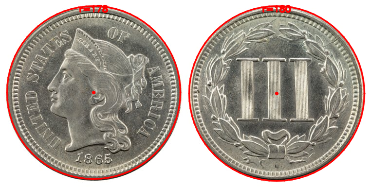
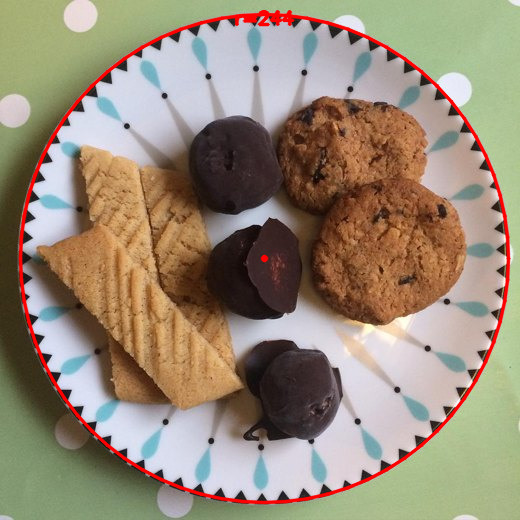

# 霍夫圆检测工具

PySide6 + OpenCV 桌面工具：导入本地图片、调整 `HoughCircles` 参数、预览检测结果并导出标注图。

## 环境

| 项 | 值 |
|---|---|
| 系统 | Ubuntu 24.04，WSL2 + WSLg |
| Python | 3.12.3 |
| OpenCV | 4.6.0（系统包 `python3-opencv`） |
| NumPy | 1.26.4 |
| PySide6 | 6.12.0 |
| Qt 平台 | `wayland`（WSLg，屏幕 1280×800） |
| 中文字体 | Noto Sans CJK SC |

venv 以 `--system-site-packages` 创建，复用系统 OpenCV 与 NumPy，仅额外安装 PySide6。`HoughCircles` 对版本与参数都敏感，复现验收时请保持上述版本。

## 安装

```bash
cd ~/rt_vision/hough_circle_tool
python3 -m venv --system-site-packages .venv
source .venv/bin/activate
pip install -e .
```

`pyproject.toml` 将 PySide6 固定为 `6.12.0`。

## 启动

```bash
source .venv/bin/activate
python -m hough_circle_tool
```

也可以使用安装后的入口 `hough-circle-tool`。

## 使用

1. 点「打开图片」，可一次选择一张或多张 JPG/JPEG/PNG/BMP。
2. 在左侧列表选择图片，右侧显示标注结果与检出数量。
3. 修改六个参数后点「重新检测」；参数改动不会自动触发检测。
4. 点「导出标注图」，默认保存为 `<原文件名>_annotated.png`。

## 验收参数

两张验收图使用同一组默认参数。预处理固定为灰度化 + `GaussianBlur(5×5, σ=2)`，检测方法为 `HOUGH_GRADIENT`。

| 图片 | dp | minDist | param1 | param2 | minRadius | maxRadius | 实际结果 |
|---|---|---|---|---|---|---|---|
| `examples/coins.jpg` | 1 | 200 | 100 | 40 | 150 | 300 | 2 个圆：`(568,192,r180)`、`(192,190,r178)` |
| `examples/cookie-plate.png` | 1 | 200 | 100 | 40 | 150 | 300 | 1 个圆：`(264,258,r244)` |

### 标注结果





## 参数说明

| 参数 | 含义 | 调整方向 |
|---|---|---|
| `dp` | 累加器分辨率与图像分辨率的反比 | 越大越粗、越快，1.0 表示同分辨率 |
| `minDist` | 圆心之间的最小距离（px） | 太小会重复检出同一圆，太大漏检相邻圆 |
| `param1` | Canny 高阈值 | 越大边缘越少 |
| `param2` | 累加器阈值 | 越小越敏感、误检增多 |
| `minRadius` | 最小半径（px） | 用于排除小圆 |
| `maxRadius` | 最大半径（px） | 用于排除大圆；必须不小于 `minRadius` |

界面范围：`dp` 0.1–4.0，`minDist` 1–2000，`param1` 1–500，`param2` 1–200，半径 0–1000。

## 测试

```bash
source .venv/bin/activate
pytest -q
```

测试覆盖默认参数、参数校验、合成圆检测、两张验收图的数量与坐标（±10 px）以及标注不修改原图。

## 目录结构

```text
src/hough_circle_tool/   # params、detector、main_window、入口
examples/                # 两张验收图与来源说明
tests/                   # 参数与检测测试
docs/                    # 任务原文、测量记录、验收标注图
openspec/                # 变更规格与任务记录
```

## 已知限制与排错

- 默认参数只在两张验收图上保证结果；其他图片需要自行调参。
- OpenCV 版本变化可能改变检测结果；升级后需重新验收并更新本表与 `docs/measurement.md`。
- WSLg 不可用时窗口无法显示；Qt 默认走 wayland。若强制 xcb，需要 `libxcb-cursor0`。
- 缺少中文字体时界面显示方框，安装 `fonts-noto-cjk` 后重启程序。
- 检测在界面线程同步执行；大图或多图时可能短暂卡顿。

## 开发约定

- 规格与验收口径见 `openspec/changes/add-hough-circle-gui/`。
- 工作分支 `feat/hough-circle-gui`，提交格式 `<type>: <short description>`。
- 改动检测参数或预处理时，必须同步更新本 README、`docs/measurement.md` 与对应测试。
